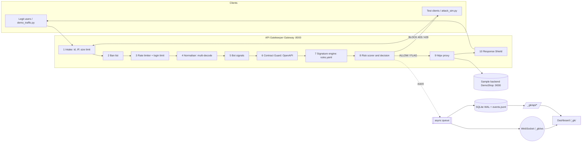
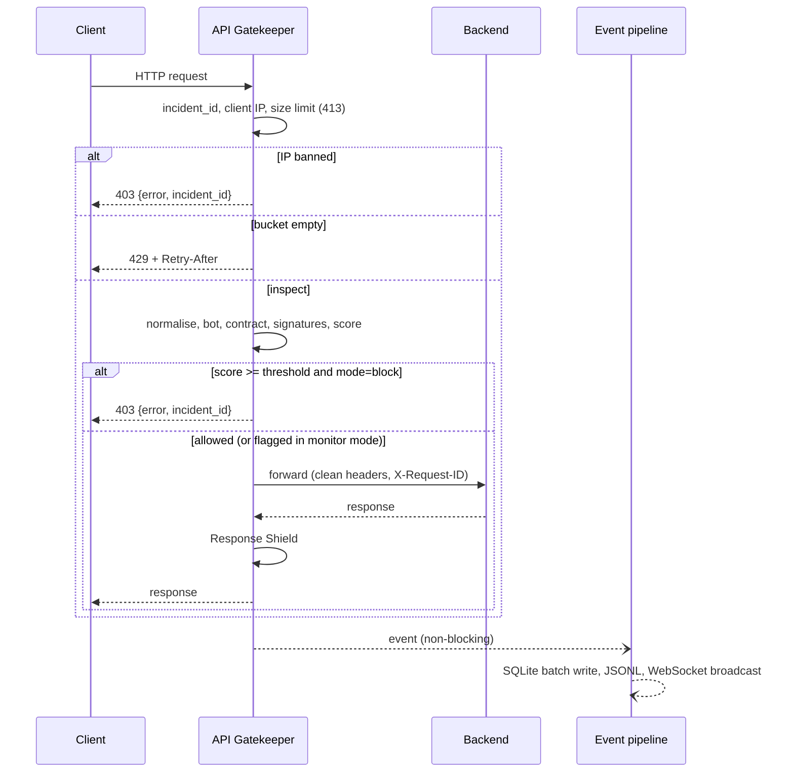

# API Gatekeeper — Master Prompt & Build Playbook
### InnoHacks 2.0 · Cybersecurity · Problem Statement: API Gatekeeper

**Team:** 3 members · **Laptops:** Windows · **AI IDE:** Antigravity · **Deployment:** local laptop demo + Render cloud backup
**Event clock:** Sprint 1 PPT (D1 1:00–4:30 PM) → Sprint 2 MVP (5:00–11:30 PM) → Sprint 3 end application (D2 1:30–10:00 AM) → Verification (10:00 AM–1:00 PM) → Evaluation 4:00 PM

---

## How to use this document

1. Do Module M0 first. It saves **Part 4 (Master Context)** into the repo as `docs/MASTER_CONTEXT.md`. Every module prompt tells the agent to read it first.
2. Build **one module per Antigravity conversation**, in order. Start each with `/plan`, review the Implementation Plan artifact, then let it proceed.
3. After each module run its acceptance checks yourself, then `git commit`. Do not start the next module while checks fail.
4. In Antigravity, set the project Security Preset so terminal commands need your review.
5. Parts 1–3 are for the team. Parts 4–5 are for the AI. Parts 6–9 cover testing, deployment, demo and risks.

---

# PART 1 — Critical review of the earlier research

| # | Issue in earlier research | Why it matters | Fix adopted |
|---|---|---|---|
| 1 | **IsolationForest rule `score_samples < -0.15` blocks everything.** Reproduced: normal samples score about −0.47 to −0.61, so 100% of normal training data is blocked. | Legitimate traffic blocked in the demo. | ML is an optional stretch module. If used: `decision_function() < 0`, trained on real benign traffic, adds score only, never blocks alone. |
| 2 | Synthetic "normal" vectors from random ranges contradict "no mock data". | Model learns nothing about the real API. | Train only on recorded benign traffic. |
| 3 | `/bare` and `/protected` in one app. | That is a router, not a gateway. | Real reverse proxy (`:8000`) in front of a separate sample backend (`:9000`). |
| 4 | Burst of 150 requests from the same IP as other attacks. | Later attacks get rate-limited, so the table shows the wrong reason. | Each scenario uses its own simulated client IP; burst runs last. |
| 5 | Command-injection regex needs trailing whitespace. | Misses `;whoami` at end, `$(id)`, backticks. | Rewritten rules, tested: 33/33 attack samples caught, 0/25 benign false positives. |
| 6 | SSRF regex flags any text containing `localhost`. | False positives. | Match only URL schemes pointing at internal/metadata addresses. |
| 7 | MITRE: XSS mapped to T1059. | Wrong; judges will notice. | Primary taxonomy is OWASP + CWE; ATT&CK only where accurate. |
| 8 | 403 returns "full explanation". | Leaks detection logic to the client. | Client sees generic 403 + incident ID; detail only on the dashboard. |
| 9 | Traversal tested with `curl /user/../..`. | Clients collapse `../` before sending. | Test through a query parameter, or `curl.exe --path-as-is`. |
| 10 | Hard-coded `ws://localhost:8000`. | Breaks on Render (needs `wss://`). | Derive from `location`. |
| 11 | Chart.js from unpinned CDN. | Venue Wi-Fi failure → blank charts. | Vendored, pinned local copy. |
| 12 | `/api/run-sim` spawns a subprocess; unauthenticated admin endpoints. | Remote trigger on a public URL. | Admin token; simulator only when `DEMO_MODE=true`. |
| 13 | Everything in one `main.py`. | Three people and AI agents → merge conflicts. | Small modules with owners. |
| 14 | Hard-coded summary "Protected: 7/7 blocked". | Fake numbers hurt credibility. | All numbers computed from real results. |
| 15 | Base64-decode "if valid". | Normal IDs are valid base64 → noise. | Decode only tokens ≥12 chars with ≥80% printable output. |
| 16 | Plain `uvicorn`. | **No WebSocket support**; live feed fails silently. | `uvicorn[standard]`. |

**Kept:** FastAPI + httpx, YAML rules, multi-decode, stdlib sqlite3, vanilla HTML + Chart.js + WebSocket, attack simulator with side-by-side results, payload tester, CSV export, phase-gated build.

---

# PART 2 — Product definition

## 2.1 One-liner
**API Gatekeeper** is a drop-in reverse-proxy security gateway. It inspects every API request, blocks injection, bot and abuse traffic, logs mapped security events, and **proves its own effectiveness** with a live scorecard. The protected API needs zero code changes.

## 2.2 Threat coverage

| Threat | Layer | OWASP | CWE | ATT&CK |
|---|---|---|---|---|
| SQL injection | Normaliser + Signatures | A05:2025 Injection | CWE-89 | T1190 |
| NoSQL operator injection | Signatures (JSON keys too) | A05:2025 | CWE-943 | T1190 |
| Cross-site scripting | Signatures | A05:2025 | CWE-79 | T1190 |
| OS command injection | Signatures | A05:2025 | CWE-78 | T1059 |
| Path traversal | Signatures | A01:2025 | CWE-22 | T1083 |
| SSRF | Signatures | API7:2023 | CWE-918 | T1190 |
| Log4Shell / JNDI | Signatures (headers too) | A05:2025 | CWE-917 | T1190 |
| Mass assignment | **Contract Guard** | API3:2023 | CWE-915 | T1190 |
| Undocumented endpoints | **Contract Guard** | API9:2023 | CWE-1059 | T1595 |
| Credential stuffing | Login rate limit + bans | API2:2023 | CWE-307 | T1110.004 |
| Floods / scraping | Token bucket + bans | API4:2023 | CWE-770 | T1499.003 |
| Scanner tools | Bot signals | A02:2025 | CWE-200 | T1595.002 |
| Error / stack-trace leakage | **Response Shield** | A02:2025 | CWE-209 | n/a |

**Out of scope (say so honestly):** object-level authorisation (OWASP API1) needs app-specific identity knowledge, so it goes in future scope. TLS is terminated by the platform.

## 2.3 Scope discipline

| Problem-statement verb | Our feature | Priority |
|---|---|---|
| Inspects requests | Normaliser, Contract Guard, Signatures, Bot signals | MVP; Contract Guard in Sprint 3 |
| Blocks suspicious traffic | Risk scoring, 403/429, auto-ban | MVP |
| Logs security events | SQLite + JSONL, incident IDs, mappings | MVP |
| Displays attack analytics | Live dashboard, charts, top attackers | MVP basic → Sprint 3 polish |
| Measurable effectiveness (differentiator) | Benchmark corpus + Security Scorecard + latency bench | Sprint 3 |
| Small apps lack protection | `pip install`, one config file, free deploy | Throughout |

**Rejected as complexity without value:** React, Redis, Kafka, Kubernetes, user accounts, LLM-in-the-loop classification, GeoIP maps, CAPTCHA.

---

# PART 3 — Architecture

## 3.1 System diagram



## 3.2 Request lifecycle



## 3.3 Decision logic

```
score = sum of rule.score for each DISTINCT rule matched (bot + contract + signatures [+ anomaly])
if ip banned:                       action = banned        -> 403
elif bucket empty:                  action = rate_limited  -> 429 + Retry-After
elif score >= BLOCK_THRESHOLD (5):  action = blocked (mode=block) | flagged (mode=monitor, forwarded)
else:                               action = allowed
strikes: blocked = +1; every 20 rate_limited = +1; >= 3 strikes in 60 s -> ban 120 s (all configurable)
```
Points follow OWASP CRS anomaly scoring (critical 5, high 4, medium 3, low 2; inbound threshold 5): one critical hit blocks, and two weaker signals together also block.

## 3.4 Repository layout

```
api-gatekeeper/
├─ gateway/
│  ├─ main.py        app factory, lifespan, routers, catch-all proxy route (registered LAST)
│  ├─ config.py      settings from env + config/gateway.yaml
│  ├─ models.py      RequestContext, Finding, Decision, Event
│  ├─ normalizer.py  multi-decode, JSON flattening, inspection targets
│  ├─ rules.py       load/compile/validate/hot-reload rules, match()
│  ├─ ratelimit.py   token buckets, strikes, bans
│  ├─ contract.py    OpenAPI Contract Guard
│  ├─ pipeline.py    orchestrates layers -> Decision (reused by dry-run and benchmark)
│  ├─ proxy.py       httpx forwarding + header hygiene
│  ├─ shield.py      Response Shield
│  ├─ events.py      queue, SQLite (WAL), JSONL, stats queries
│  ├─ ws.py          WebSocket manager
│  ├─ admin.py       /_gk/api/* router + token guard
│  ├─ benchmark.py   corpus runner -> scorecard
│  ├─ anomaly.py     (stretch) IsolationForest
│  └─ static/ index.html, app.js, styles.css, vendor/chart.umd.js
├─ config/   gateway.yaml, rules.yaml
├─ backend/  app.py, seed.py            DemoShop: harmless, secure sample API
├─ tools/    attack_sim.py, demo_traffic.py, latency_bench.py
├─ tests/    test_*.py, corpus/ (attacks_dev.yaml, attacks_holdout.yaml, benign.yaml)
├─ docs/     MASTER_CONTEXT.md, DEMO_SCRIPT.md
├─ data/     runtime, gitignored
└─ requirements.txt, run_backend.bat, run_gateway.bat, run_demo.bat, start.sh, README.md
```

## 3.5 Control-plane endpoints (namespaced so they never collide with proxied paths)

| Method | Path | Purpose |
|---|---|---|
| GET | `/_gk/` | Dashboard |
| GET | `/_gk/health` | Gateway + upstream health (no auth) |
| WS | `/_gk/ws` | Live event stream (client ping every 25 s) |
| GET | `/_gk/api/stats?window=900` | KPIs |
| GET | `/_gk/api/events?limit=&action=&category=` | Event list |
| GET | `/_gk/api/events/{incident_id}` | Incident detail (decode chain, findings) |
| GET | `/_gk/api/timeline?bucket=10&window=900` | Allowed vs blocked series |
| GET | `/_gk/api/top-attackers?limit=10` | IP leaderboard |
| POST | `/_gk/api/test` | Dry-run inspection of a crafted request. Never forwarded. |
| GET/POST | `/_gk/api/mode` | `block` / `monitor` |
| GET / POST / PATCH | `/_gk/api/rules`, `/rules/reload`, `/rules/{id}` | View / hot-reload / toggle |
| GET / DELETE | `/_gk/api/bans`, `/bans/{ip}` | Ban list / unban |
| POST / GET | `/_gk/api/benchmark`, `/benchmark/latest` | Run / read scorecard |
| GET | `/_gk/api/export.csv` | CSV export |
| POST | `/_gk/api/simulate` | Run attack_sim in background (only if `DEMO_MODE=true`) |
| * | `/{anything}` | Proxied through the pipeline |

All `/_gk/api/*` and `/_gk/ws` require `X-Admin-Token` (or `?token=`) when `ADMIN_TOKEN` is set.

## 3.6 Event model (SQLite table `events`)

`id`, `incident_id` (`AG-YYYYMMDD-HHMMSS-xxxx`, unique), `ts`, `client_ip`, `method`, `path`, `query` (≤1 KB), `user_agent` (≤256), `body_excerpt` and `decoded_excerpt` (≤2 KB), `action` (allowed · blocked · flagged · rate_limited · banned · error_masked), `score`, `primary_category`, `severity`, `findings` (JSON list of `{layer, rule_id, name, category, score, matched, target, cwe, owasp, attack}`), `status_code`, `latency_ms`, `upstream_ms`, `reached_backend` (bool).

Indexes on `ts`, `action`, `client_ip`. `journal_mode=WAL`, `synchronous=NORMAL`. A single background task drains an `asyncio.Queue` and writes in batches every 250 ms. Never write to SQLite in the request path.

## 3.7 Technology stack

| Layer | Choice | Why |
|---|---|---|
| Language | Python 3.12 | Whole team reads it; one language for gateway, tests, simulator |
| Gateway | FastAPI + `uvicorn[standard]` | Async; `[standard]` provides WebSocket support |
| Proxy client | httpx `AsyncClient`, one shared instance | Pooling, timeouts |
| Rules | YAML + precompiled `re` | Hot-reloadable, readable by judges |
| Contract | `jsonschema` on the backend's OpenAPI | Validates bodies against the API's own spec |
| Storage | stdlib `sqlite3` (WAL) + JSONL | No server; JSONL is SIEM-friendly |
| Dashboard | HTML + vanilla JS + Chart.js 4.4.1 (vendored) + WebSocket | No build step, no CDN at the venue |
| Backend | FastAPI "DemoShop" + SQLite, parameterised queries | Safe, realistic, documented OpenAPI |
| Testing | pytest, corpus runner, OWASP ZAP baseline, latency bench | Unit + effectiveness + independent tool + performance |
| Deploy | Render free web service, one service runs backend on 127.0.0.1 and gateway on `$PORT` | Free, WebSockets supported, git-push deploy |
| Stretch ML | scikit-learn IsolationForest | Only on real benign traffic; contributes score |

`requirements.txt`: `fastapi`, `uvicorn[standard]`, `httpx`, `pyyaml`, `jsonschema`, `pytest`. After it works, run `pip freeze > requirements.lock.txt` and commit. `requirements-ml.txt`: `scikit-learn`, `numpy` (stretch only).

## 3.8 Team responsibilities

| Member | Role | Owns modules | Also owns |
|---|---|---|---|
| **A: Gateway Engineer** | Core pipeline, performance | M0, M2, M3 (engine), M4, M8 | Git hygiene, merges, latency numbers |
| **B: Security & Testing** | Rules, corpus, evidence | M1, M3 (rules + dev corpus), M7, M9 | ZAP baseline, regression suite, threat-model Q&A |
| **C: Dashboard, Deploy & Demo** | Everything judges see | M5 (WS side), M6, M10, M11, PPT | Writes the hold-out and benign corpus **without opening rules.yaml**, demo script, presenter, backup video |

**Hold-out rule:** C writes `attacks_holdout.yaml` and `benign.yaml`. B tunes rules only against `attacks_dev.yaml`. This gives you an honest detection number.

## 3.9 Timeline

| Window | A (Gateway) | B (Security) | C (Dashboard/Demo) | Exit gate |
|---|---|---|---|---|
| D1 1:00–4:30 PM Sprint 1 | Review stack slide; M0 only if coding is allowed | Draft dev corpus on paper | **PPT** (owner), architecture diagram | PPT submitted |
| 5:00–7:30 PM | M2 proxy core → M3 engine | M1 backend → rules + dev corpus | Hold-out + benign corpus → M5 events/WS | Proxy forwards; a SQLi-style probe gets 403 |
| 8:30–11:30 PM | M4 rate limit and bans | M7 attack_sim (basic) | M6 dashboard (KPIs, feed, 2 charts) | **MVP submitted by 11:30** |
| D2 12:01–1:30 AM | Fix MVP bugs, rest | Rest | Render dry-run deploy | |
| 1:30–4:30 AM | **M8 Contract Guard** | M9 Shield → M7 benchmark/scorecard | M10 admin controls + incident drawer | Scorecard shows real numbers |
| 5:00–7:30 AM | Latency bench + fixes | Regression, FP tuning (dev set only) | **M11 Render deploy**, polish | Cloud URL works end to end |
| 8:30–10:00 AM | **Feature freeze 9:00** | Final hold-out run, freeze numbers | Backup video, rehearse ×2 | Demo under 5 min |
| 10:00–1:00 PM | Bug fixes only | Evidence pack | Judge-dashboard prep, warm cloud | |

---

# PART 4 — MASTER CONTEXT (M0 saves this as `docs/MASTER_CONTEXT.md`)

```markdown
# API Gatekeeper — Master Context for AI Coding Agents

## Mission
API Gatekeeper is a reverse-proxy security gateway for REST APIs, built for the InnoHacks 2.0 hackathon
(problem: "API Gatekeeper"). It inspects every request, blocks malicious traffic, logs security events,
and shows attack analytics on a live dashboard. Differentiators: (1) OpenAPI Contract Guard,
(2) a built-in Security Scorecard measuring detection rate, false-positive rate and latency.
This is a DEFENSIVE product. We build detection, blocking, logging and analytics only.

## Topology
- Sample backend "DemoShop": FastAPI on 127.0.0.1:9000 (backend/app.py). Harmless and written securely
  (parameterised queries, validated input). It is only the thing being protected.
- Gateway: FastAPI on 0.0.0.0:8000 (gateway/main.py). Control plane under /_gk/*. All other paths are proxied.
- Run with ONE uvicorn worker (rate-limit and ban state are in memory).

## Hard constraints
1. Python 3.12. Must run on Windows 10/11 (cmd and PowerShell) and Linux (Render). Use pathlib. Use 127.0.0.1,
   never "localhost". Windows run instructions must not use bash-only syntax.
2. Dependencies ONLY: fastapi, uvicorn[standard], httpx, pyyaml, jsonschema, pytest
   (+ scikit-learn, numpy only in the stretch anomaly module). Add nothing else.
3. Frontend: plain HTML + CSS + vanilla JS + Chart.js 4.4.1 from gateway/static/vendor/chart.umd.js.
   No CDN, no frameworks, no build step.
4. Never execute OS commands, read system files or make outbound requests based on request content, anywhere.
   The backend must be secure; it must not contain deliberately exploitable code.
5. No TODOs, stubs, placeholder data or fake numbers. Every metric shown is computed from real events.
6. Client-facing block responses are generic: {"error": "...", "incident_id": "..."}. Never reveal rule ids,
   patterns or scores to the client. Detail goes only to logs and the dashboard.
7. No SQLite writes in the request path: events go through an asyncio.Queue drained by one background writer.
8. Only modify files listed in the current module's scope.
9. Type hints on all functions; small functions; a module docstring explaining purpose.
10. After implementing, run the module's tests/checks, SHOW the output, then STOP and wait.

## Pipeline order (gateway/pipeline.py)
intake (incident_id, client IP, 1 MB limit -> 413) -> ban check -> rate limit -> normalise -> bot signals ->
contract guard -> signature rules -> [anomaly, stretch] -> score and decide -> proxy -> response shield -> emit event.
`inspect(ctx) -> Decision` is a pure function of request + current state so /_gk/api/test and the
benchmark reuse it in dry-run mode without forwarding.

## Scoring
critical=5, high=4, medium=3, low=2; sum of DISTINCT matched rules; BLOCK_THRESHOLD=5.
mode=block -> 403. mode=monitor -> forward, action "flagged".
Strikes: blocked +1, every 20 rate_limited +1; >=3 strikes in 60 s -> ban 120 s. Values in config/gateway.yaml.

## Client IP resolution (CLIENT_IP_SOURCE)
"socket" (default): request.client.host · "xff_first": first X-Forwarded-For entry (LOCAL DEMO ONLY, lets the
simulator present many client IPs) · "xff_last": last entry (behind exactly one trusted proxy, e.g. Render).

## Normaliser
For each inspection target produce variants: raw; iterative decode up to 3 rounds until stable of
(urllib.parse.unquote_plus -> html.unescape -> unicodedata NFKC -> strip \x00); then collapse SQL inline
comments /**/ to a space and whitespace runs to one space. Base64 only for tokens matching
[A-Za-z0-9+/_-]{12,}={0,2}, decoded, kept only if >=80% printable ASCII.
JSON bodies: flatten recursively; inspect BOTH keys and values. Form bodies: parse_qs.
Targets: path, each query value (+ raw query), body keys/values, header values, user-agent.
Record the decode chain for the dashboard.

## Rules (config/rules.yaml)
Fields: id, name, category, pattern (Python regex, SINGLE-QUOTED in YAML), targets [path|query|body|headers|ua],
score, severity, cwe, owasp, attack, enabled (default true). Compile at load; an invalid regex is logged and
skipped, never crashes. Hot-reload via POST /_gk/api/rules/reload.

## Response Shield
Upstream status >= 500: replace body with {"error":"Internal error","incident_id":...}, log action "error_masked".
Strip Server and X-Powered-By. Add X-Content-Type-Options: nosniff, X-Frame-Options: DENY,
Referrer-Policy: no-referrer, Cache-Control: no-store, Content-Security-Policy: default-src 'none'
(proxied API responses only, NOT the dashboard).

## Proxy hygiene
One shared httpx.AsyncClient (created in lifespan, closed on shutdown), timeout 10 s, follow_redirects=False.
Strip hop-by-hop headers and host; add X-Forwarded-For and X-Request-ID=incident_id. Drop content-encoding and
content-length from responses. Upstream down -> 502 generic JSON.

## Dashboard WebSocket URL
(location.protocol==='https:'?'wss':'ws') + '://' + location.host + '/_gk/ws'. The catch-all proxy route is registered LAST.

## Env / config
UPSTREAM_URL=http://127.0.0.1:9000 · GATEWAY_MODE=block · ADMIN_TOKEN= (empty = open, local only) ·
DEMO_MODE=true · CLIENT_IP_SOURCE=socket · DATA_DIR=data · OPENAPI_SOURCE=upstream (or a file path)
```

---

# PART 5 — Modules and copy-paste prompts

Paste one prompt per new Antigravity conversation, starting with `/plan`.

---

## M0 · Scaffold (Owner A · 20 min)

**Acceptance:** `python -m venv .venv`, activate, `pip install -r requirements.txt` succeed on all three laptops; `python -c "import yaml;print(len(yaml.safe_load(open('config/rules.yaml'))['rules']))"` prints `16`.

```
TASK (Module M0: scaffold only, no application code).
First create docs/MASTER_CONTEXT.md with exactly the content I paste below, and treat it as binding for all
future work.
[PASTE PART 4 CONTENT HERE]

Then:
1. Create folders: gateway/static/vendor, config, backend, tools, tests/corpus, docs, data.
2. .gitignore: .venv/, data/, __pycache__/, *.db, *.jsonl, .pytest_cache/
3. requirements.txt with exactly: fastapi, uvicorn[standard], httpx, pyyaml, jsonschema, pytest.
   requirements-ml.txt: scikit-learn, numpy.
4. config/gateway.yaml with: upstream_url, mode: block, block_threshold: 5, max_body_bytes: 1048576,
   rate_limit {capacity: 20, refill_per_sec: 5}, login_rate_limit {path_regex: '^/api/login$', capacity: 5,
   refill_per_sec: 0.0833}, strikes {window_sec: 60, ban_threshold: 3, ban_sec: 120, rate_limited_per_strike: 20},
   contract {enabled: true, strict_extra_fields: true, unknown_query_param_score: 2,
   sensitive_fields: [role, is_admin, isAdmin, admin, balance, price, permissions, verified]},
   client_ip_source: socket. Comment that env vars override yaml.
6. Windows scripts: run_backend.bat (activate .venv, uvicorn backend.app:app --host 127.0.0.1 --port 9000),
   run_gateway.bat (uvicorn gateway.main:app --host 127.0.0.1 --port 8000), run_demo.bat (start both in separate
   windows with `start "name" cmd /k ...`). start.sh for Linux/Render: start the backend in the background on
   127.0.0.1:9000, then exec uvicorn gateway.main:app --host 0.0.0.0 --port ${PORT:-8000}.
7. README.md: 5-step Windows quick start using cmd.
Do NOT create Python modules. Do NOT add packages. Show the tree, then STOP.
```
*Then manually: copy the provided `rules.yaml` into `config/`, and save Chart.js 4.4.1 (`https://cdn.jsdelivr.net/npm/chart.js@4.4.1/dist/chart.umd.js`) as `gateway/static/vendor/chart.umd.js`.*

---

## M1 · DemoShop sample backend (Owner B · 30 min)

**Requirements:** a small, safe REST API with a full OpenAPI spec (M8 consumes it). All SQL uses parameters; all inputs validated by Pydantic. It exists only so the gateway has something realistic to protect.

**Acceptance:** `http://127.0.0.1:9000/openapi.json` lists every endpoint with request schemas; `curl.exe "http://127.0.0.1:9000/api/products?search=phone"` returns JSON; a backend request logs the headers it received (so you can show `X-Request-ID` arrives through the gateway).

```
Read docs/MASTER_CONTEXT.md and follow all hard constraints.
TASK (Module M1: backend/app.py and backend/seed.py only).
Build "DemoShop", a small, SECURE sample API that API Gatekeeper will protect, on 127.0.0.1:9000.
- seed.py: recreate data/demoshop.db on start with tables users(id, username, email, password_hash, role) holding
  5 fake users (emails @demoshop.test, password_hash = salted hash of fake passwords) and
  products(id, name, category, price, stock) holding 12 products.
- app.py, with Pydantic models, tags and summaries so OpenAPI is complete:
  GET  /api/health
  GET  /api/products?search=&category=&limit=   (parameterised LIKE query, limit 1..50)
  GET  /api/products/{product_id}               (int path param, 404 if missing)
  POST /api/login      {username, password} -> {"token": "..."} (constant-time compare; 401 on failure)
  POST /api/register   {username, email, password} only; extra fields are ignored by Pydantic (extra="ignore")
  POST /api/feedback   {product_id, comment (max 500 chars)} -> stored and returned escaped as JSON data
  GET  /api/orders/{order_id}                   (returns a canned demo order)
- Middleware that prints one line per request: method, path, and the X-Request-ID header if present.
- No endpoint may build SQL by string concatenation, run commands, read arbitrary files or call out to URLs.
Run it, show the openapi.json endpoint list and two sample responses, then STOP.
```

---

## M2 · Proxy core (Owner A · 45 min)

**Requirements:** `config.py`, `models.py`, `proxy.py`, `main.py` with the catch-all route, `/_gk/health`, request IDs, size limit, header hygiene. No inspection yet.

**Acceptance:** all requests to `:8000` return the same body and status as `:9000`; the backend log shows `X-Request-ID`; stop the backend → gateway returns 502 JSON; a 2 MB body → 413; a `Connection: keep-alive` client header is not forwarded.

```
Read docs/MASTER_CONTEXT.md and follow all hard constraints.
TASK (Module M2: gateway/config.py, models.py, proxy.py, main.py only).
Implement the transparent reverse proxy with NO inspection yet:
1. config.py: Settings loaded from config/gateway.yaml with env-var overrides (see Env/config in the master context).
2. models.py: dataclasses RequestContext, Finding, Decision (action, score, findings, status), Event.
3. proxy.py: one shared httpx.AsyncClient created in the FastAPI lifespan; forward method, path, query,
   body and filtered headers per "Proxy hygiene"; stream the response back with filtered headers.
4. main.py: app factory with lifespan; GET /_gk/health (gateway ok + upstream reachable bool);
   catch-all route for every method that generates incident_id (AG-YYYYMMDD-HHMMSS-xxxx), enforces
   max_body_bytes (413), forwards via proxy.py. Register the catch-all LAST.
5. tests/test_proxy.py using httpx.AsyncClient + a mock upstream to verify: passthrough, hop-by-hop removal,
   X-Request-ID added, 502 when upstream is down, 413 on oversized body.
Run pytest and manual curl checks, show output, then STOP.
```

---

## M3 · Normaliser + signature engine + pipeline (Owners A + B · 75 min)

**Requirements:** `normalizer.py`, `rules.py`, `pipeline.py`, tests. Wire pipeline into the proxy route. Rules come from `config/rules.yaml` (provided; B tunes on the dev corpus only).

**Acceptance (all must pass):**
- `pytest tests/test_normalizer.py tests/test_rules.py` green.
- Double-URL-encoded, HTML-entity-encoded and `/**/`-split variants of the same probe produce the same rule hit.
- JSON body with an operator-style key (e.g. a `$ne` key) is detected.
- Benign samples in `tests/corpus/benign.yaml` (names with apostrophes, "union" in a bank name, "select a plan", etc.) produce **zero** hits.
- A blocked request returns `403 {"error":"Request blocked","incident_id":"AG-..."}` and the backend never sees it.

```
Read docs/MASTER_CONTEXT.md and follow all hard constraints.
TASK (Module M3: gateway/normalizer.py, rules.py, pipeline.py; wire into gateway/main.py; tests).
1. normalizer.py per "Normaliser" in the master context. Expose
   build_targets(ctx) -> dict[target_name, list[Variant]] where Variant has .text and .chain (list of decode steps).
2. rules.py: load config/rules.yaml, validate fields, precompile (skip + log invalid), match(variants_by_target)
   -> list[Finding] using DISTINCT rule ids, honour `enabled`, support hot reload and PATCH toggle.
   Run each rule against its declared targets on every variant (and lowercased).
3. pipeline.py: inspect(ctx) -> Decision implementing bot (ua target), signatures, scoring and the
   block/monitor logic from the master context. It must be pure so dry-run and benchmark can reuse it.
4. In main.py's catch-all: call inspect(); on block return the generic 403 JSON; otherwise proxy as before.
5. Tests: test_normalizer.py (double encoding, HTML entities, inline-comment collapsing, base64 rules, JSON key
   flattening), test_rules.py (loads every rule; for each rule category at least 2 positive and 2 benign cases
   written by you in the test file), test_pipeline.py (threshold arithmetic: one critical blocks; low+low does not;
   low+medium blocks; monitor mode forwards and marks "flagged").
Show full pytest output and a curl demo of one allowed and one blocked request, then STOP.
```

---

## M4 · Rate limiting, bot signals, bans (Owner A · 45 min)

**Requirements:** token bucket per client IP (general) plus stricter bucket for the login path; strikes → temporary ban; `Retry-After` header; ban list in memory with expiry.

**Acceptance:** 30 rapid requests from one client IP → first ~20 pass, rest get 429 with `Retry-After`; 6th login attempt within a minute → 429; three blocked requests inside 60 s → next request gets 403 `banned`; ban expires after 120 s; a second client IP is unaffected; unit tests use an injectable clock (no `sleep`).

```
Read docs/MASTER_CONTEXT.md and follow all hard constraints.
TASK (Module M4: gateway/ratelimit.py; integrate in pipeline.py; tests/test_ratelimit.py).
1. TokenBucket with injectable clock; RateLimiter keyed by (client_ip, scope) where scope is "general" or "login"
   (login when the request path matches login_rate_limit.path_regex). Use config capacities/refills.
2. Strike tracker and ban list per "Scoring" in the master context. Expose is_banned(ip), add_strike(ip, reason),
   list_bans(), unban(ip). Prune expired entries lazily (no background thread).
3. In pipeline order: ban check -> rate limit -> rest. rate_limited returns 429 + Retry-After, banned returns 403.
   Both emit incident_ids and Decision objects like any other block.
4. Tests with a fake clock for: bucket refill, login bucket, strikes -> ban -> expiry, independence between IPs.
Show pytest output and a manual burst test using a short Python loop, then STOP.
```

---

## M5 · Event store, WebSocket, stats API (Owner C · 60 min)

**Acceptance:** after sending 10 mixed requests, `GET /_gk/api/events` returns 10 rows with findings; `data/events.jsonl` has 10 lines; `/_gk/api/stats` counts equal the DB; a WebSocket client (`python -c` with `websockets` from `uvicorn[standard]`, or the browser console) receives an event within 1 s; killing the DB writer task does not break request handling.

```
Read docs/MASTER_CONTEXT.md and follow all hard constraints.
TASK (Module M5: gateway/events.py, ws.py, admin.py; integrate in main.py and pipeline/proxy; tests/test_events.py).
1. events.py: SQLite (WAL) schema per "Event model"; asyncio.Queue + one background writer in the lifespan batching
   every 250 ms; also append JSONL; stats queries: totals, per-action counts, by category, timeline buckets,
   top attackers, unique IPs, reached_backend count, p50/p95 latency for the last window.
2. ws.py: connection manager with broadcast(event_dict); drop dead sockets; server ping.
3. admin.py: router at /_gk/api implementing stats, events, events/{incident_id}, timeline, top-attackers,
   export.csv, with the X-Admin-Token guard from the master context.
4. Emit one event per request (allowed included) from the catch-all route after the response is known, without
   blocking the request path.
5. Tests: events written and queryable, queue batching, CSV export columns, token guard (401 without token when set).
Show pytest output and sample JSON from /_gk/api/stats, then STOP.
```

---

## M6 · Live dashboard (Owner C · 90 min)

**Layout (single page, `gateway/static/index.html`, `app.js`, `styles.css`, dark theme):**
1. Top bar: "API GATEKEEPER — LIVE DEFENSE", connection dot (green when WebSocket is connected), mode badge (BLOCK/MONITOR).
2. KPI cards: Total requests · Blocked · Rate-limited · Allowed · Unique attacker IPs · **Block rate** · **p95 latency**.
3. Live attack feed: severity-coloured cards (category, IP, short payload, rule name, OWASP/CWE tags, time). Click → incident drawer.
4. Charts: doughnut (attack categories), line (allowed vs blocked per 10 s). Chart.js from `/_gk/static/vendor/`.
5. Top attackers table and active bans list.
6. Payload tester: method, path, query, body, headers → POST `/_gk/api/test` → shows decision, score, each finding and the decode chain.
7. Buttons: Run Attack Simulator, Run Scorecard, Export CSV.

**Acceptance:** loads with zero console errors and no external network requests; counters update live while the simulator runs; works at 1366×768 and 1920×1080; reconnects automatically if the WebSocket drops; WebSocket URL is derived from `location`.

```
Read docs/MASTER_CONTEXT.md and follow all hard constraints (vanilla JS, vendored Chart.js, no CDN).
TASK (Module M6: gateway/static/index.html, app.js, styles.css; mount static at /_gk/static and serve index at /_gk/).
Build the dashboard exactly as specified in the layout list (7 sections above). Requirements:
- Initial load: fetch /_gk/api/stats, /events?limit=50, /timeline, /top-attackers, /bans, then connect to the WebSocket
  for live events and update counters, feed, charts and tables incrementally (no full reload).
- Auto-reconnect with backoff; show a clear "disconnected" state.
- Token: read ?token= once, store in sessionStorage, send as X-Admin-Token on every fetch.
- Incident drawer shows: incident ID, time, IP, method+path, decoded form, every finding (layer, rule, matched text,
  CWE, OWASP, ATT&CK), score vs threshold bar, action taken, latency, reached_backend.
- Dark theme, monospace for payloads, red accent, severity colours (critical red, high orange, medium yellow, low blue),
  colour-blind-safe (do not rely on colour alone: add severity text).
- Escape ALL event fields before inserting into the DOM (use textContent). The dashboard displays attacker-controlled
  strings, so it must itself be XSS-safe.
Open it in a browser, post a few requests via curl, and show screenshots or a description of each section working. STOP.
```

---

## M7 · Attack simulator, corpus, Security Scorecard (Owners B + C · 90 min)

**Concept:** the scorecard is your differentiator. It replays a labelled corpus through `pipeline.inspect()` in dry-run mode and reports **detection rate (attacks blocked / attacks), false-positive rate (benign blocked / benign), per-category recall, and latency**. Dev and hold-out sets are reported separately.

**Corpus format (`tests/corpus/*.yaml`):**
```yaml
- id: sqli-014
  category: sqli
  label: attack          # or benign
  method: GET
  path: /api/products
  query: {search: "<probe string>"}
  body: null
  headers: {}
```
**Corpus sizing:** ≥60 dev attacks, ≥40 hold-out attacks (C writes, without opening rules.yaml), ≥80 benign. Sources of probe strings: your own knowledge of common WAF test patterns and the public OWASP Core Rule Set regression tests. Include evasion variants (double encoding, case mixing, comment splitting, Unicode fullwidth). Benign set must be **hard**: names like O'Brien, "Union Bank", "drop me a line", "select a plan", code snippets in comments, URLs to public sites, JSON with `$` in prices.

**Acceptance:** `python -m gateway.benchmark` prints hold-out detection ≥ 95% and false positives ≤ 2% (if lower, B fixes *rules* using the dev set only, never by copying hold-out strings into rules); `POST /_gk/api/benchmark` returns the same JSON; results saved to `data/benchmark_latest.json`; the simulator sends each scenario from its own client IP (via `X-Forwarded-For` with `CLIENT_IP_SOURCE=xff_first`), the burst scenario runs last, and the summary numbers are computed, not hard-coded.

```
Read docs/MASTER_CONTEXT.md and follow all hard constraints.
TASK (Module M7: tools/attack_sim.py, tools/demo_traffic.py, gateway/benchmark.py, tests/corpus/*, admin endpoints).
1. gateway/benchmark.py: load corpus files, build a RequestContext per case, call pipeline.inspect() in dry-run
   (no forwarding, no event emission, no rate-limit state mutation), and produce JSON:
   {dev:{detection, fp_rate, per_category:{...}, missed:[ids], false_positives:[ids]}, holdout:{...},
    latency_ms:{p50,p95,p99}, generated_at}. Provide `python -m gateway.benchmark`.
2. Endpoints: POST /_gk/api/benchmark (run), GET /_gk/api/benchmark/latest.
3. tools/attack_sim.py (uses httpx): scenarios by category (SQLi probe, XSS probe, command-chaining probe,
   traversal probe, SSRF-style probe, obfuscated/double-encoded probe, scanner User-Agent, mass-assignment body,
   undocumented endpoint, login flood, request burst). Each scenario uses its own X-Forwarded-For client IP; the burst runs
   last. Print a table: scenario, status returned, blocked?, rule category, latency. End with a summary computed
   from the results. Targets the GATEWAY URL given by --url (default http://127.0.0.1:8000).
   Probe strings are short, standard, harmless-by-construction test strings; nothing is executed anywhere.
4. tools/demo_traffic.py: sends realistic benign traffic (searches, product views, logins, feedback) at a
   configurable rate so the dashboard shows allowed traffic alongside attacks.
5. POST /_gk/api/simulate runs attack_sim in a background subprocess ONLY when DEMO_MODE=true and token valid.
6. Seed tests/corpus/attacks_dev.yaml with 60 cases across all categories; hold-out and benign files are written by
   Member C separately, so create only the loader and ONE example each.
Show the scorecard JSON from the dev set and the simulator table, then STOP.
```

---

## M8 · OpenAPI Contract Guard (Owner A · 75 min) — Sprint 3 priority

**Concept:** a positive security model. Fetch the backend's `/openapi.json`, build an allow-list of (method, path-template) pairs, then validate query params and JSON bodies against the schema. This catches what signatures cannot: unknown endpoints, wrong types, oversized fields, and injected extra fields such as `role`.

**Scoring:** unknown endpoint 5 (block); schema type/format violation 4; extra field in a body 3 (5 if the field name is in `sensitive_fields`); unknown query param 2; oversized string vs `maxLength` 3. Never block a spec-valid request on contract grounds. Fail open (log a warning, skip) if the spec cannot be loaded, but show "Contract Guard: inactive" on the dashboard.

**Acceptance:** `GET /admin` (not in spec) → 403; register body with `"role":"admin"` → 403; `limit=abc` → 403; valid requests unchanged; spec reload works (`POST /_gk/api/rules/reload` also refreshes it); `pytest tests/test_contract.py` green.

```
Read docs/MASTER_CONTEXT.md and follow all hard constraints.
TASK (Module M8: gateway/contract.py; integrate in pipeline.py; tests/test_contract.py).
1. On startup (and reload) load the OpenAPI document from OPENAPI_SOURCE (upstream /openapi.json by default).
   Build a router from path templates (e.g. /api/products/{product_id}) to operations, with parameter and
   requestBody schemas. Use jsonschema (Draft 2020-12) for validation; resolve local $refs.
2. Return Findings with layer="contract", rule ids CONTRACT-UNKNOWN-ENDPOINT, CONTRACT-SCHEMA, CONTRACT-EXTRA-FIELD,
   CONTRACT-SENSITIVE-FIELD, CONTRACT-UNKNOWN-PARAM, CONTRACT-OVERSIZE, with the scores listed above, CWE-915 for
   mass assignment, CWE-1059 for inventory, owasp API3:2023 / API9:2023.
3. Do not apply the contract to /_gk/* paths. Allow OPTIONS and HEAD to known paths.
4. Fail open with a logged warning and `contract_active=false` in /_gk/api/stats if the spec is unavailable.
5. Tests: unknown endpoint, wrong type, extra field, sensitive extra field, unknown param, valid request passes,
   path-template matching for /api/products/{product_id}, fail-open behaviour.
Show pytest output and curl checks, then STOP.
```

---

## M9 · Response Shield (Owner B · 30 min)

**Acceptance:** a backend 500 never reaches the client verbatim (client gets generic JSON + incident ID; event action `error_masked`); `Server` and `X-Powered-By` stripped; security headers present on proxied responses; dashboard routes are unaffected.

```
Read docs/MASTER_CONTEXT.md and follow all hard constraints.
TASK (Module M9: gateway/shield.py; integrate in proxy.py/main.py; tests/test_shield.py).
Implement the Response Shield exactly as in the master context. Include a temporary test route in the TEST
upstream mock (not in backend/app.py) that returns a 500 with a fake stack-trace string, to prove masking.
Show pytest output, then STOP.
```

---

## M10 · Admin controls and polish (Owner C · 45 min)

**Requirements:** mode toggle (block/monitor) with confirmation, rule table with enable/disable switches and hot reload, unban buttons, "reached backend" counter that visibly changes between modes, empty-state and error-state UI.

**Acceptance:** toggling to monitor and re-running the simulator shows the same attacks as FLAGGED with `reached_backend=true`; toggling back to block shows them blocked with `reached_backend=false`; disabling one rule makes the corresponding probe flagged as allowed, and re-enabling restores blocking.

```
Read docs/MASTER_CONTEXT.md and follow all hard constraints.
TASK (Module M10: gateway/admin.py additions + dashboard files).
Implement GET/POST /_gk/api/mode, GET/PATCH /_gk/api/rules, POST /_gk/api/rules/reload, GET/DELETE /_gk/api/bans,
and the dashboard controls described above. Add a "Reached backend" KPI and a before/after banner that shows the
counts for the last 60 s in each mode. All changes must be token-guarded and reflected live over WebSocket.
Show a walkthrough of toggling modes with the simulator running, then STOP.
```

---

## M11 · Deployment to Render + Windows demo runner (Owner C · 60 min)

See Part 8. **Acceptance:** public `https://<name>.onrender.com/_gk/?token=...` loads, WebSocket connects (`wss://`), simulator runs, scorecard computes; `run_demo.bat` starts everything on a clean Windows laptop in under 60 s.

```
Read docs/MASTER_CONTEXT.md and follow all hard constraints.
TASK (Module M11: deployment files only).
1. start.sh (Linux/Render) and render.yaml: one web service, Python runtime, build `pip install -r requirements.txt`,
   start `bash start.sh`, health check path /_gk/health, env vars: ADMIN_TOKEN (generated, sync:false),
   GATEWAY_MODE=block, DEMO_MODE=true, CLIENT_IP_SOURCE=xff_first (demo only so the simulator can show multiple
   client IPs; document the trade-off), UPSTREAM_URL=http://127.0.0.1:9000, PYTHON_VERSION=3.12.
   The backend binds 127.0.0.1 only; only the gateway listens on $PORT.
2. Make data paths work on ephemeral disks (create DATA_DIR on start; recreate the demo DB on boot).
3. Add /_gk/health to answer within 200 ms without touching upstream when ?shallow=1.
4. Write DEPLOY.md with exact step-by-step Render instructions and a pre-demo warm-up checklist.
5. Verify run_demo.bat and start.sh locally. Show the final file contents, then STOP.
```

---

## M12 · STRETCH ONLY: anomaly scoring (Owner A · only if M0–M11 are green and time remains)

**Rules:** optional dependency; if scikit-learn is missing the layer silently disables. Train only on events with `action=allowed` captured by `demo_traffic.py` (≥300 events). Features: path length, number of params, body bytes, Shannon entropy of the query + body, special-character ratio, header count, method code. Fit `IsolationForest(contamination=0.02, random_state=42)`; use `decision_function()`; if `< 0` add a **medium (3)** finding named `ANOMALY-001`. It can never block alone (3 < 5) but can tip a borderline request over the threshold.

**Acceptance:** on a held-out sample of benign events, anomaly flags ≤ 3%; scorecard false-positive rate does not worsen; if either fails, **delete the module and do not mention ML as shipped**; present it as future scope instead.

---

# PART 6 — Testing strategy

| Level | What | Tool | Pass criterion |
|---|---|---|---|
| Unit | normaliser, rules, buckets, bans, contract, shield | pytest | all green; ≥85% of gateway code lines exercised |
| Effectiveness | dev + **hold-out** corpus via dry-run pipeline | `python -m gateway.benchmark` | hold-out detection ≥95%; benign FP ≤2%; every miss listed |
| Evasion | double/triple encoding, case mixing, comment splitting, fullwidth Unicode, JSON-key operators | corpus category `evasion` | ≥90% detected |
| Integration | gateway + backend + dashboard, end to end | attack_sim + demo_traffic | blocked probes never appear in backend log; allowed traffic passes unchanged |
| Independent tool | OWASP ZAP baseline scan pointed at **your own** local gateway | ZAP (Docker or desktop app) | scan completes; blocked/alerted behaviour recorded; no gateway crashes |
| Performance | 1000 sequential + 50 concurrent requests, allowed and blocked paths | `tools/latency_bench.py` | gateway overhead p95 < 20 ms vs direct backend; no memory growth over 5 minutes |
| Robustness | 1 MB body, malformed JSON, invalid UTF-8, huge headers, 5000-char query, binary body | pytest | never 500 from the gateway itself; always a decision |
| Self-security | dashboard XSS (event fields rendered with textContent), admin token required, no rule detail in client responses, backend not reachable from outside | manual checklist | all items checked |
| Regression | rerun everything after every rule change | `pytest -q` + benchmark | no category recall drops |

**Honesty rules for numbers shown to judges:** report hold-out and dev separately; show missed cases; state the corpus size; never tune rules on hold-out; say "measured on our corpus" not "99% secure".

**Self-security checklist:** (1) every dashboard field escaped; (2) `ADMIN_TOKEN` set in cloud; (3) `DEMO_MODE` understood and documented; (4) gateway never echoes matched rule text to clients; (5) request size, header count and decode depth capped; (6) regex patterns reviewed for catastrophic backtracking (use bounded quantifiers; benchmark one 5000-char adversarial input per rule; each rule must finish in < 5 ms); (7) error paths always return generic JSON.

---

# PART 7 — Acceptance criteria summary (definition of done)

| # | Criterion | Measure |
|---|---|---|
| 1 | Transparent proxy | Responses identical to direct backend for the benign corpus |
| 2 | Injection blocking | ≥95% hold-out detection across 7 injection categories |
| 3 | Low false positives | ≤2% on the hard benign set |
| 4 | Abuse control | Burst → 429s; login flood → 429; repeat offenders banned and later released |
| 5 | Contract Guard | Unknown endpoint, wrong type, injected field all blocked; valid traffic untouched |
| 6 | Logging | 100% of requests produce an event with incident ID and mappings; JSONL and DB agree |
| 7 | Dashboard | Live feed < 1 s; works offline (no CDN); XSS-safe; reconnects |
| 8 | Performance | p95 overhead < 20 ms |
| 9 | Deployment | Cloud URL works, WebSocket over wss, token-protected |
| 10 | Demo resilience | Local demo runs with Wi-Fi off; backup video exists |

---

# PART 8 — Deployment

## 8.1 Local (primary demo path, Windows)
```
python -m venv .venv
.venv\Scripts\activate
pip install -r requirements.txt
run_demo.bat
```
Open `http://127.0.0.1:8000/_gk/`. Run the demo from `127.0.0.1`; this avoids venue Wi-Fi, firewall prompts (allow Python on private networks once, beforehand) and cold starts. Set `CLIENT_IP_SOURCE=xff_first` locally so the simulator can show several client IPs.

## 8.2 Render (cloud backup for judges)
1. Push the repo to GitHub (private is fine).
2. Render → New → Web Service → connect repo. Runtime: Python 3. Build: `pip install -r requirements.txt`. Start: `bash start.sh`. Health check path: `/_gk/health?shallow=1`.
3. Environment: `ADMIN_TOKEN` (long random), `GATEWAY_MODE=block`, `DEMO_MODE=true`, `CLIENT_IP_SOURCE=xff_first`, `UPSTREAM_URL=http://127.0.0.1:9000`.
4. After deploy, open `https://<service>.onrender.com/_gk/?token=<ADMIN_TOKEN>`.

**Known free-tier behaviour (verified in Render docs):** the service spins down after 15 minutes without inbound traffic and takes about a minute to wake (WebSocket messages on an open connection count as traffic); the filesystem is ephemeral (the demo DB and logs reset on redeploy or restart, which is fine because they are re-seeded); 750 free instance hours per month. **Mitigation:** open the dashboard and run `demo_traffic.py --url <render-url>` 5 minutes before judging; keep a tab open.

**Cloud caveat:** with `CLIENT_IP_SOURCE=xff_first` clients can spoof their IP; acceptable for a demo, **must** be `xff_last` or `socket` in any real deployment, and say so in Q&A.

---

# PART 9 — Demo strategy (5 minutes, rehearse twice)

**Story arc: "Any API, protected in minutes, and we prove it works."**

| Time | Act | What you show | Line to say |
|---|---|---|---|
| 0:00 | Hook | One slide stat (87% of orgs had an API incident) → live dashboard, all zeros | "Small apps have nothing in front of their API. This is what sits there." |
| 0:30 | Setup | Terminal: `run_demo.bat`; backend log on one side, dashboard on the other | "Zero changes to the backend. It just points at the gateway." |
| 1:00 | Normal traffic | Start `demo_traffic.py`; allowed counter climbs, p95 latency shown | "Legitimate users never notice us." |
| 1:30 | Monitor mode | Toggle to MONITOR, run the simulator; attacks flagged and "Reached backend" counter climbs | "Without blocking, every one of these reaches the backend." |
| 2:15 | Block mode | Toggle to BLOCK, run again; feed lights up, reached-backend stays flat; open one incident drawer (decode chain, rule, CWE/OWASP) | "Same attacks, now stopped, with an explanation." |
| 3:00 | Differentiator 1 | Obfuscated probe via the payload tester (double-encoded) → still caught; then a request with an injected `role` field → Contract Guard blocks | "Signatures alone miss this. We validate against the API's own contract." |
| 3:40 | Abuse | Login flood → 429 → temporary ban appears in the ban list | "Bots get slowed, then removed." |
| 4:10 | Differentiator 2 | Run the **Security Scorecard**: hold-out detection %, FP %, latency | "We don't claim effectiveness; we measure it, on attacks our rule-writers never saw." |
| 4:45 | Close | Export CSV, mention cloud URL, future scope | "One pip install. Small teams can adopt it today." |

**Judge-proofing:**
- **Backup:** a 3-minute screen recording of the full flow, stored locally and on a phone.
- **Offline:** the dashboard has no external assets; test with Wi-Fi off.
- **Reset button:** a "Clear demo data" action (token-guarded) to start from zero before judges arrive.
- **Dry-run endpoint** lets a judge type their own payload and see the decision live; prepare for them to try creative evasions. Never claim 100%.
- **Division of speaking:** C presents and drives the dashboard; B narrates the security reasoning and handles tester input; A answers architecture/performance questions.

**Likely judge questions (prepare answers):**
1. *How is this different from a WAF like ModSecurity/Cloudflare?* Lightweight, API-aware (OpenAPI positive security), measurable, zero infrastructure; not a replacement for enterprise WAFs.
2. *False positives?* Show the hard benign set and the measured rate; monitor mode lets teams tune before blocking.
3. *Can attackers bypass regexes?* Yes, which is why we layer: normalisation, contract validation, rate limits, bans and scoring; the scorecard shows evasion results honestly.
4. *Scalability?* Single process now; next step is Redis-shared state and multiple gateway instances.
5. *Where does ML fit?* Optional anomaly signal trained on real benign traffic; it never blocks alone. (Only say this if M12 passed.)
6. *What about object-level authorisation (BOLA)?* Needs app-specific identity knowledge; future scope.

---

# PART 10 — Risk register

| Risk | Likelihood | Mitigation |
|---|---|---|
| Regex false positives hurt demo | Medium | Hard benign corpus; monitor mode; scores not single-rule blocks for weak signals |
| Regex catastrophic backtracking | Low | Bounded quantifiers; per-rule timing test |
| Windows firewall/port prompts | High | Pre-allow Python; use `127.0.0.1`; test on demo laptop |
| Wi-Fi / cloud cold start | High | Local-first demo; warm cloud 5 min early; backup video |
| Merge conflicts | Medium | Module ownership; small commits; A merges |
| Scope creep | High | Feature freeze 9:00 AM Day 2; M12 only if all else green |
| Over-claiming numbers | Medium | Hold-out separation; show misses; "measured on our corpus" |
| AI agent drift | Medium | Master context in repo; one module per conversation; stop-and-verify gates |
| Sleep deprivation | High | 45-minute rests at 12:01 AM; present from a script |

---

# PART 11 — Information still needed from you

1. **Team name, college name, member names, Problem Statement ID** (for slide 1).
2. **Rules on coding before Sprint 2:** can you write code during Sprint 1 (1:00–4:30 PM)? This decides whether M0/M1 start now.
3. **Judging criteria weights** (innovation vs implementation vs presentation), if published.
4. **Required submission artefacts** for MVP and final (repo link, deployed URL, video, report?).
5. **Python version** on all three laptops (`python --version`); 3.12 is the target, 3.10+ works.
6. **Roles:** confirm who is A, B, C (the allocation above assumes one gateway-focused, one security-focused, one dashboard/demo-focused member).
